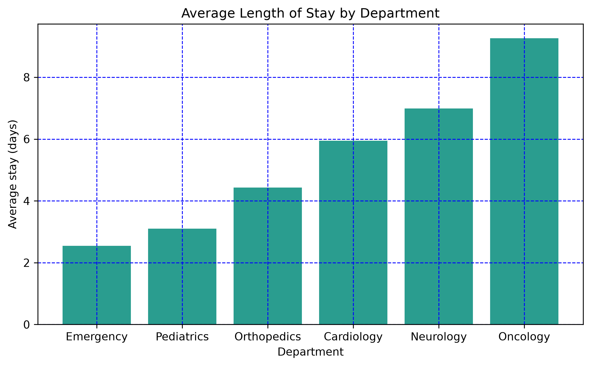

# hospital-admissions-analysis
 Python analysis of synthetic hospital data using pandas and matplotlib. 

# Hospital Admissions Analysis

A data analysis project using Python, pandas and matplotlib on a
synthetic dataset of 3,000 hospital admissions (2024-2025).

> **Note:** All data is synthetic and was generated for practice.
> No real patient information is used.

## Question
Which hospital departments keep patients the longest?

## Dataset
`hospital_admissions.csv` has 3,000 rows and 11 columns: patient_id,
admission_date, department, age, gender, bmi, systolic_bp,
length_of_stay, billing_amount, readmitted_30d, satisfaction_score.

## Method
1. Loaded the data with pandas and checked data types and missing values
2. Grouped admissions by department and calculated the average length of stay
3. Visualised the result as a sorted bar chart with matplotlib

## Key Findings
- Oncology has the longest average stay at about 9.3 days
- Emergency has the shortest at about 2.5 days
- About 12% of patients were readmitted within 30 days

## Chart

## Tools
Python, pandas, matplotlib, Jupyter Notebook, VS Code

## Next steps
- Add a boxplot to show the spread of stays
- Analyse readmission rates over time
